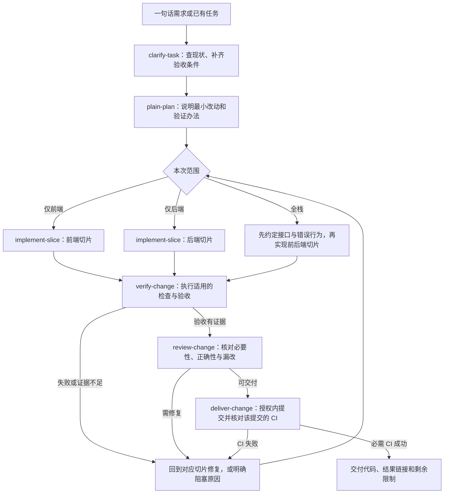

# AI 全栈开发工作流开源调研：2026-10-17—2026-10-23

`agent-skills` 的目标是让开发者从一句话需求出发，经过需求澄清、方案、实现、验证和审查，交付有 CI 结果的代码；同一流程既能服务前端，也能服务后端和前后端协作。

**建议先建设六个可独立使用的节点，保留现有 `plain-plan`，再按需接入工程工具。** 需求与拆分优先借鉴 Matt Pocock 和 Superpowers；复杂变更参考 OpenSpec；浏览器验证优先试用 Playwright CLI；Java 与前端规则按项目技术栈加载；交付结果由项目已有测试和 CI 确认。不要一次安装多套完整工作流，让它们同时争夺流程控制权。

这是调研与建设建议。当前仓库仍只有 `plain-plan`；下文的节点、评测和接入方案均未实现，也没有跨模型实测结果。

## 1. 本次怎样检索与筛选

检索日期为 **2026-10-23，北京时间**。“最近一周”采用近七个自然日：**10 月 17 日 00:00 至 10 月 23 日本次检索时刻**。这不是一份“全部在本周诞生”的项目榜单；成熟项目本周的修复，以及本周没有更新但适合作为基础的材料，都分别标明。

从公开网络搜索、[GitHub 周趋势页](https://github.com/trending?since=weekly)和候选官方仓库发现项目，再读取 README、实际技能或脚本、许可证、发布记录和提交。趋势页只用于发现，不用星数证明效果。子代理负责分组取证，主模型负责筛选和组合。

筛选依据是：能否解决具体开发节点的问题、是否能指出可复用文件、是否有测试或 CI 等可检查材料、是否容易脱离特定模型、接入成本是否适合当前小仓库。优先级是针对本项目的判断，不是通用排名。

证据分为三种：

- **已核实材料**：实际读取的技能、源码、发布说明和 CI 页面。代码链接固定到提交，避免以后随 `main` 变化。
- **上游声明**：例如支持多个宿主或模型，只代表文档声明，不代表本次已逐一验证。
- **待试验建议**：本报告提出的组合方式、节点和评测方案。

本轮未安装候选工具、未执行上游脚本、未构建示例项目，也未调用付费模型做对比。已有 CI 成功只说明相应任务在上游环境的结果；它不能证明接入本仓库后有效。

## 2. 最近一周有哪些值得关注的实际变化

下表时间均已换算为北京时间。发布采用 GitHub 的 `published_at`，提交采用对应提交时间；不使用搜索收录时间、`pushed_at` 或 Atom 的最后更新时间代替。

| 项目 | 本周证据 | 实际变化及对本项目的意义 |
|---|---|---|
| Superpowers | [v7.0.1，10/22 05:05][superpowers-release] | 澄清前先读项目与指定材料，提问说明答案会改变什么。适合减少没有上下文的连续追问。 |
| OpenSpec | [v1.14.3，10/17 09:52][openspec-release] | 生成模板补充 glob 产物路径边界，另修复零宽终端下验证卡住。路径要求属于提示指令，不是运行时文件沙箱。 |
| Spec Kit | [v1.2.3，10/22 21:33][speckit-release]；周内还有 v1.2.1、v1.2.2 | 共享脚手架 `integration none`、`.presetignore`、Python JSON 输出兼容修复。新增 MCP 能力清单，但源码明确尚无已注册的 workflow adapter。 |
| agent-browser | [v0.39.2，10/23 03:52][browser-release] | 修复隐藏、禁用、视口外元素点击假报成功，以及旧引用恢复歧义等。对可信浏览器验收直接相关。 |
| Jeffallan/claude-skills | [v0.4.20，10/17 00:31][jeff-release] | `execute-ticket` 要求先记录目标验收测试正确失败的证据，再实现至通过。Spring 技能本身不是本周新增。 |
| PR-Agent | [v0.48.0，10/17 03:55][pr-release] | 增加审查 JSON 导出、可选失败场景等。适合给审查结果建立可读取的输出；不等同于测试结论。 |
| Playwright CLI | [提交 b1a5903，10/20 05:35][pw-change] | 更新检查遵循 npm registry/proxy，并补测试。浏览器操作和测试生成流程是既有能力，不是本周新增。 |
| promptfoo | [提交 2eed6e1，10/21 10:57][promptfoo-change] | 增加 provider 独立环境配置及作用域测试。本次未核到周内正式发布；最近 CLI release 0.124.1 为 10/8。 |
| reviewdog | [提交 22d5659，10/22 20:49][reviewdog-change] | SARIF 解析跳过 `pass`、`notApplicable`，避免把通过或不适用结果误报为问题。最近发布 v0.21.2 为 9/19，不含此修复。 |
| GitHub Agentic Workflows | [v0.93.2，10/23 13:57][ghaw-release] | 完善安装回退与校验，拒绝将空或不完整 Grype 扫描当作零问题成功。值得借鉴“没有完成检查不能报通过”。 |

另有三类重要基线：

- **mattpocock/skills**：[周内提交][matt-change]只涉及 `chief-of-staff` 记忆调整；本报告推荐的需求与拆分节点没有本周新功能。[当前目录][matt-readme]已使用 `to-spec`、`to-tickets`，不能沿用旧文章中的 `write-a-prd` 名称描述最新版。
- **Vercel agent-skills、Anthropic skills**：所查默认分支没有周内提交；这里借鉴的是既有前端规则、联调脚本和技能评测方法。[Vercel 技能][vercel-react]、[Anthropic README][anthropic-readme]
- **Agent Skills 标准库**：所查默认分支最近提交在 8 月，不是本周新品。仍值得用它检查技能包格式。[规范][standard-spec]

## 3. 各开发节点最值得借鉴什么

### 3.1 需求与拆分：优先借鉴小技能，按复杂度选择文档量

| 候选与具体资产 | 借鉴内容 | 接入判断与依赖 | 已核对许可 |
|---|---|---|---|
| Matt Pocock：[to-spec][matt-spec]、[to-tickets][matt-tickets] | 把已澄清讨论收敛为规格；任务按可独立验收的纵向切片拆分，写清真实依赖。 | **优先借鉴写法。** `to-spec` 本身不访谈，需前置澄清。可用本地任务文件，不必依赖工单 SaaS。 | [MIT][matt-license] |
| Superpowers：[brainstorming][superpowers-brainstorm]、[writing-plans][superpowers-plan] | 先查已有能力，再问影响方案的问题；计划写具体路径、动作和验证步骤。 | **优先借鉴局部。** 完整流程有设计确认及审阅回合；小修复不必原样执行全部步骤。未固定模型，但宿主能力仍需适配。 | [MIT][superpowers-license] |
| OpenSpec：[schema.yaml][openspec-schema]、[propose 模板][openspec-propose] | proposal、行为增量、design、tasks 之间有明确依赖；实现任务同时依据需求与设计。 | **复杂变更参考。** CLI 需 Node ≥20.19，还要维护 schema 与产物目录。当前仓库先借鉴依赖关系，暂不引入整套 CLI。 | [MIT][openspec-license] |
| Spec Kit：[spec-template][speckit-spec]、[tasks 指令][speckit-tasks]、[setup_plan.py][speckit-script] | 用户故事、需求编号、验收条件与任务互相对应；任务带文件路径和并行标记。 | **备选完整流程。** Python ≥3.11、uv 及受支持宿主；多份文档适合较大任务。与 OpenSpec 二选一试点，不默认叠加。 | [MIT][speckit-license] |

对本项目的取舍：先让“每个任务对应哪条验收条件”可见，再考虑独立 PRD、设计和任务文件。小需求可以放在一份简短变更记录里；已有文档能表达清楚就复用。Spec Kit 的 [MCP 清单源码][speckit-mcp]目前只是能力与副作用描述，不能把它作为现成的节点执行引擎。

### 3.2 前端与 Java 后端：规则应按技术栈加载

**前端优先参考 Vercel agent-skills。** [React 技能][vercel-react]按影响和类别组织规则，每条可继续读具体示例；适合在相关改动时加载。它偏 React/Next.js，不能拿来要求 Vue 或所有前端项目采用同样实现。技能与 README 声明 MIT，但所查根目录未见独立 LICENSE 文件；后续如复制内容，应先落实所复制文件的授权和声明。仓库有 [规则检查 CI][vercel-ci]，这不等于应用性能提升已被验证。

**Java 后端优先把 Jeffallan 的 [spring-boot-engineer][jeff-spring]作为检查提纲。** 它面向 Boot 3.x / Security 6，按 Web、数据、安全和测试任务加载参考资料。适合提醒模型检查输入、注入方式和事务边界；实际实现仍以目标项目版本和已有设施为准。该仓库为 [MIT][jeff-license]。完整工单流程绑定 Jira/Confluence，Spring 技能本身不要求这些服务，不必一起引入。

两者都不提供“任意技术栈生成代码必然正确”的证据。本项目更需要在实现前读版本、依赖、构建命令和现有调用方，并在技能说明中写明适用范围。

### 3.3 浏览器验收与前后端联调：区分探索、断言和运行环境

| 候选与具体资产 | 适合做什么 | 接入限制与选择 | 许可 |
|---|---|---|---|
| Microsoft [Playwright CLI 技能][pw-skill]与[测试生成参考][pw-generation] | 探索应用，记录操作素材；指导代理补充预期断言、保存 `.spec.ts` 并运行 Playwright Test。 | **第一版优先试用。** CLI 输出动作代码，不自动补齐业务断言。需终端、Node ≥18、Playwright 和浏览器；所查包使用 alpha 版 Playwright，接入需固定版本。 | [Apache-2.0][pw-license] |
| Vercel [agent-browser dogfood][browser-dogfood] | 探索真实流程、空态、错误与边界输入；问题附复现步骤、截图和视频。 | **作为替代浏览器工具评估。** 需 CLI、Chrome/Chromium 和相关 shell 能力。dogfood 是既有技能，本周主要更新底层工具。 | [Apache-2.0][browser-license] |
| Anthropic [webapp-testing][webapp-skill]与[with_server.py][webapp-script] | 启动一个或多个本地服务，等待就绪，执行验收命令并清理。 | **先复用现有启动设施；缺少时再借鉴脚本。** 依赖 Python 与浏览器测试环境。源码只检查 TCP 端口，不证明接口或数据库已健康；真实联调要检查业务就绪条件。 | 该技能目录 [Apache-2.0][webapp-license] |

选择 Playwright CLI 作为首个试点，是因为它提供从探索到补充断言、保存测试的清晰步骤；这仍是选型建议，没有本仓库实测。其 [b1a5903 对应 CI][pw-ci]在 Ubuntu、Windows、macOS 的测试成功，但不证明业务验收已覆盖。

agent-browser 的可靠性修复值得关注，不过 v0.39.2 对应提交 `50c34e78` 的 [CI run][browser-ci]整体为失败：Native E2E 成功，Windows Rust 失败，macOS x64 取消。因此不把它写成已验证的全平台默认工具。这不等于已经证明它在目标 Mac 上不可用，需单独试验。

### 3.4 审查与 CI：模型建议和机器检查分别保留

**reviewdog 适合汇总已有检查器的结果。** 它把检查输出映射到变更行，本身不需要大模型；[配置与 README][reviewdog-readme]可作为前端 lint、Java 静态检查等工具统一反馈的参考。其 [MIT 许可证][reviewdog-license]已核对。注意[默认 `-fail-level=none`][reviewdog-flags]，发现问题仍可能返回 0；“没发评论”也不代表“没有问题”。接入时应明确哪些检查必须失败退出，并保留原始报告。

**PR-Agent 适合补充语义审查。** 现址是 `The-PR-Agent/pr-agent`；[审查实现][pr-reviewer]和[配置][pr-config]包含测试审查、可选失败场景及结构化输出。所查 v0.48.0 为 [MIT][pr-license]，模型通过 LiteLLM 等配置连接，仍需要模型端点与 Git 平台权限。建议先让它输出可核实的问题，不让模型的合入建议代替测试或直接决定合并。其 [Action 包装][pr-action]还提示需要分别固定包装提交与运行镜像 digest，只固定 Action SHA 不足以固定镜像内容。

**GitHub Agentic Workflows 暂放在后续阶段。** [README][ghaw-readme]说明它把 Markdown 工作流编译成 GitHub Actions，支持多种 AI 引擎；[safe outputs][ghaw-outputs]把模型提出的写入请求交给单独受控任务处理。许可为 [MIT][ghaw-license]。它依赖 GitHub、引擎认证、运行器和额外配置，适合已有 CI 后的失败调查与维护自动化。第一版仍让普通 CI 执行构建、测试和 lint；不需要先搭建自动运行的 AI 平台。

### 3.5 技能自身的质量：格式检查与真实效果都要验证

**Agent Skills 标准库提供最小格式基础。** [规范][standard-spec]支持 `SKILL.md` 搭配可选 `scripts/`、`references/`、`assets/`；[validator.py][standard-validator]检查名称、目录和元数据等，不能判断需求是否做对。`skills-ref` 需 Python ≥3.11，代码为 [Apache-2.0][standard-code-license]，文档为 [CC-BY-4.0][standard-doc-license]。建议优先复用这个格式，不自行发明一套不兼容的技能包。

**Anthropic skill-creator 值得借鉴“有技能与无技能对比”的方法。** [汇总脚本][creator-aggregate]和[数据结构][creator-schemas]记录通过率、耗时和 token 的统计信息；该目录为 [Apache-2.0][creator-license]。但[触发评测脚本][creator-run]实际依赖 `claude -p`、`.claude/commands/` 和 Claude 事件，不能直接当跨模型评测器。可借鉴数据与比较方法，执行部分应适配具体宿主。

**promptfoo 可用于之后的输出回归与模型对比。** 它提供多 provider 和结构化评测输出，所查代码为 [MIT][promptfoo-license]，Node 要求见 [package.json][promptfoo-package]。但它的模型输出评测不能自动证明生成的前后端项目能运行；仍需接入真实项目验收。还查到一个具体接入风险：[CI 指南][promptfoo-guide]含 `eval --fail-on-error`，而所查[命令定义][promptfoo-cli]未定义此选项，[执行代码][promptfoo-exit]实际使用通过率阈值与失败退出码。其[独立工作流示例][promptfoo-workflow]还默认使用 `--share`。因此不要原样复制示例；应固定版本、核对 CLI，并用一次预期失败验证 CI 确实会拦住错误，数据分享按实际需要开启。

### 3.6 暂不作为第一版核心的项目

- **BMAD-METHOD**：本周有[需求拆分改动][bmad-change]，但[所查 main README][bmad-readme]明确是 V7 preview alpha，稳定线为 V6.12。角色、工单树、渲染器和迁移配套较多，当前不需要为六个节点引入这些设施。其[许可证正文为 MIT，另有商标声明][bmad-license]。
- **Dancan254/spring-boot-skills**：有[按版本分流的测试技能][dancan-testing]，但面向 Boot 4。它可以成为 Boot 4 专项备查，不能作为所有 Java 后端项目的默认规则。
- **大而全的技能合集、多个完整 agent 平台**：这次不凭目录数量或星数引入。只有确定某个节点缺什么，才挑其中的具体文件或工具试验。

## 4. `agent-skills` 第一版怎样组织

下面是本报告的建议，不是当前仓库已有功能。**先做六个节点；读代码、拆任务和选择工具放在对应节点里，不急于拆成更多技能。**

实线表示处理顺序或返回修改；前后端可以并行，但只有接口约定稳定、修改路径互不冲突时才并行。图已做结构检查，本轮未运行 Mermaid 渲染器。

| 节点 | 读取什么 | 产出什么 | 怎样判断可以进入下一步 |
|---|---|---|---|
| `clarify-task`（拟新增） | 原始需求、目标仓库、现有行为 | 目标、范围、非目标、可检查的验收条件 | 能自行查明的事实已查；真正改变业务含义的未知已回答或明确阻塞。 |
| `plain-plan`（已有，拟补充接力说明） | 验收条件、直接相关实现与调用方 | 最小改动、涉及位置、验证办法 | 每项改动能对应需求；允许给出“不需要修改”的结论。 |
| `implement-slice`（拟新增） | 方案、当前分支与已有改动、项目约定 | 一个可独立验收的代码切片及必要测试/文档 | 变更限于目标；前后端共享行为一致；未偷偷加入新框架或无关改造。 |
| `verify-change`（拟新增） | 当前代码、验收条件、项目已有检查命令 | 命令、环境、退出码、报告及结果解释 | 正常主路径和相关失败路径有证据；未运行、跳过、失败不能写成通过。 |
| `review-change`（拟新增） | 需求、固定版本的差异、验证证据 | 有位置、有触发条件的问题与处置 | 确认问题已解决或明确接受；必要检查缺失时不能声明可发布。 |
| `deliver-change`（拟新增） | 用户授权、修复后提交、必需 CI 检查 | 提交/PR、CI 链接、结果与限制 | CI 对应最终提交，必需任务真实成功；等待、取消或未触发都不算完成。 |

只有前端时，使用已确认的接口或 mock 进行前端开发，并明确哪些集成行为尚未验证；不自动建设后端。只有后端时，以接口、权限、数据和集成测试为主，不强制启动浏览器。全栈任务先约定字段、错误、权限和边界，再分别实现与联调。

例如“增加我的订单查询页”：澄清节点确认是否分页、谁能看什么；方案节点核对现有查询接口；后端切片保障查询范围与分页；前端切片处理加载、空态和失败；验证节点同时证明正常用户能查到自己的订单，以及不能读取别人的订单。最后交付与这些行为对应的检查结果。这只是说明流程的示例，不是本轮要实现的新业务。

### 节点如何接力，又不增加很多文档

第一版可在现有需求或变更记录里约定少量共同信息：**目标、验收条件、允许改动范围、当前代码版本、下一步、验证结果和未决事项**。小任务共用一份记录，大任务再分文件。换模型或恢复会话时读这份记录及最新代码，不只依赖上一个模型的口头总结。

第一版由主代理依据流程说明和当前结果选择下一节点；技能文件和流程图本身不会自动调度或强制执行检查。每个节点至少有三种结果：完成、需要返工、因缺少信息或条件而阻塞。跳过检查要记录原因；代码变化后，与该改动有关的旧验证结果要重新核对。不要在第一版额外建立数据库、调度器或通用状态引擎。

技能正文说明“何时用、输入、动作、输出与失败处理”；重复且确定的操作才放脚本。项目已有 Maven/Gradle、前端测试、启动脚本和 CI 时直接调用。宿主的工具名、安装方式和授权机制放在各自适配说明里，避免写进每个通用节点。

### “任何模型都能用”应怎样定义

可以追求通用格式、明确输入输出和可替换工具，但不能承诺任何模型都有相同交付质量。至少要分别验证：

1. **能加载**：宿主能发现技能，或能显式读取说明；专有 frontmatter 不被误解。
2. **能执行**：实际具备文件、终端、浏览器和 Git 等需要的工具与权限；缺能力时明确停在哪一步。
3. **能交付**：在固定仓库和任务上，产出的代码通过真实验收，且没有越界修改。

模型兼容表应记录模型版本、宿主版本、工具版本和测试日期；“文件能读取”不能标成“全流程通过”。子代理可处理独立取证和明确切片，方案选择与冲突解决由主代理负责；并行数和模型档位由实际成本与任务决定。

## 5. 建设顺序与验收办法

### 第一阶段：一条最小开发链

保留 `plain-plan`，补齐上述五个节点以及一份简短的接力说明。先选一个 Java 后端任务和一个前端任务，各自沿用现有测试工具跑完整条链；小任务不强制生成多份设计文档。技能格式参考 Agent Skills，需求与拆分借鉴 Matt Pocock / Superpowers 的局部方法。

完成条件不是“写好了五份 SKILL.md”，而是任务从需求走到最终代码与对应 CI，正常路径成功，关键错误能被发现；没有环境或授权的步骤如实标明尚未完成。提交、推送在已有授权内执行；没有授权的外部动作才另行确认，不重复批准同一范围。

### 第二阶段：补真实全栈证据

增加一个前后端集成任务，试用 Playwright CLI；如果现有项目无法管理联调服务，再参考 `with_server.py`。React 与 Spring 的专项参考按需加载，审查时可试用 reviewdog 汇总已有检查。修复节点变更后，重跑受影响的验收，不机械重复所有检查。

### 第三阶段：用对照试验决定是否继续加工具

先按 skill-creator 的思路记录有技能/无技能的对照结果；需要批量比较输出时再评估 promptfoo。PR-Agent 与 GitHub Agentic Workflows 放在现有代码验证和普通 CI 稳定之后。每引入一个工具，都要能说明它解决了前两阶段发现的哪个具体问题。

建议固定同一个仓库提交、需求、工具环境和预算，比较“无工作流”“本项目工作流”，必要时增加一个上游流程作为基线。覆盖至少以下场景，并保留独立验收，不只让生成代码的模型自评：

| 场景 | 重点检查 |
|---|---|
| 需求缺少关键业务条件 | 是否先查现状，只询问真正影响行为的问题。 |
| 前端表单或列表 | 加载、空态、错误、键盘操作和真实提交是否符合验收。 |
| Java 接口修改 | 正常调用、权限、边界数据及已有调用方是否都正确。 |
| 前后端集成 | 字段、错误处理、权限和真实服务调用是否一致；mock 不能冒充真实联调。 |
| 已有未提交改动 | 是否保留用户代码，是否仅修改授权范围。 |
| CI 失败、跳过或结果过期 | 能否识别未完成，并对最终提交重新取得必要结果。 |

每个场景重复运行，记录验收通过次数/总次数、人工纠正次数、越界修改、耗时和模型费用；预算不足时缩小样本，并明确样本数，不报虚假的稳定性结论。评测时若模型或工具执行失败，也应进入统计，而不是丢弃后只保留成功样本。

本次交付止于这份有来源的调研及 README 入口。没有把第三方源码复制进仓库，没有建立新的自动任务，也没有把候选项目的许可证改成仓库的 MIT。未来若实际复制文件，应针对文件保留来源、固定版本和适用的许可证/声明；通过外部工具接入时也应固定工具版本。

## 6. 固定来源索引

下面列出本次实际阅读的关键快照，正文链接直接指向具体技能、代码或发布。发布与默认分支提交分别列明：看到周内提交，不表示它已经进入最近发布包。快照是取证依据，不是经过本项目验收的安装版本。

| 项目 | 本次主要源码快照 | 推荐关注的节点 |
|---|---|---|
| mattpocock/skills | `5beb35b040e3de97e54fa9e386d7e42d15c295c2` | 规格、任务拆分 |
| obra/superpowers | `2ce8aa15d05bd57213e6f746f953aafb7ded7a8b` | 澄清、计划 |
| Fission-AI/OpenSpec | `56ef0ac1fd2270e88d276b40da9f23ec0f9c6e96` | 复杂变更的产物依赖 |
| github/spec-kit | `27d14e20c187c1f2916540ea201ecbdc9f8ed588` | 需求与任务对应 |
| vercel-labs/agent-skills | `063bee94c3f4df8453406c830b0a7df0f2860278` | React 实现规则 |
| Jeffallan/claude-skills | `02b05028ba6c93f7aed45314b15c0dd5abead9d6` | Spring 实现参考 |
| microsoft/playwright-cli | `b1a5903c5b633b8c9f843ad7b629c2a78437040c` | 浏览器验收与测试编写 |
| vercel-labs/agent-browser | `50c34e78c98dbe8add0b3ff36b4bcd7a47f1022b` | 探索验收与复现证据 |
| anthropics/skills | `dbd4588f9e1033efb41dad4bef2f7947c8993d44`；skill-creator 目录取 `b9e19e6f44773509fbdd7001d77ff41a49a486c1` | 联调辅助、技能评测 |
| reviewdog/reviewdog | `22d56597a1ceaf7c08dbf0cb51d39e088b53d70d` | 检查结果反馈 |
| The-PR-Agent/pr-agent | `981344be2755e303df501e18e3f60b848a188a80` | 模型审查 |
| promptfoo/promptfoo | `c2f6a848aca5f7e01491d2533f3fb1122bc63c50` | 模型输出回归 |
| agentskills/agentskills | `69ef37e9424c0a7ea9dd2293b559e43ec8176379` | 技能格式与校验 |
| github/gh-aw | `764fdc608e552558e4e15ffebec8e2953feb18d7` | 后续 AI 仓库自动化 |

[matt-readme]: https://github.com/mattpocock/skills/blob/5beb35b040e3de97e54fa9e386d7e42d15c295c2/README.md
[matt-change]: https://github.com/mattpocock/skills/commit/5beb35b040e3de97e54fa9e386d7e42d15c295c2
[matt-spec]: https://github.com/mattpocock/skills/blob/5beb35b040e3de97e54fa9e386d7e42d15c295c2/skills/engineering/to-spec/SKILL.md
[matt-tickets]: https://github.com/mattpocock/skills/blob/5beb35b040e3de97e54fa9e386d7e42d15c295c2/skills/engineering/to-tickets/SKILL.md
[matt-license]: https://github.com/mattpocock/skills/blob/5beb35b040e3de97e54fa9e386d7e42d15c295c2/LICENSE
[superpowers-release]: https://github.com/obra/superpowers/releases/tag/v7.0.1
[superpowers-brainstorm]: https://github.com/obra/superpowers/blob/2ce8aa15d05bd57213e6f746f953aafb7ded7a8b/skills/brainstorming/SKILL.md
[superpowers-plan]: https://github.com/obra/superpowers/blob/2ce8aa15d05bd57213e6f746f953aafb7ded7a8b/skills/writing-plans/SKILL.md
[superpowers-license]: https://github.com/obra/superpowers/blob/2ce8aa15d05bd57213e6f746f953aafb7ded7a8b/LICENSE
[openspec-release]: https://github.com/Fission-AI/OpenSpec/releases/tag/v1.14.3
[openspec-schema]: https://github.com/Fission-AI/OpenSpec/blob/56ef0ac1fd2270e88d276b40da9f23ec0f9c6e96/schemas/spec-driven/schema.yaml
[openspec-propose]: https://github.com/Fission-AI/OpenSpec/blob/56ef0ac1fd2270e88d276b40da9f23ec0f9c6e96/src/core/templates/workflows/propose.ts
[openspec-license]: https://github.com/Fission-AI/OpenSpec/blob/56ef0ac1fd2270e88d276b40da9f23ec0f9c6e96/LICENSE
[speckit-release]: https://github.com/github/spec-kit/releases/tag/v1.2.3
[speckit-spec]: https://github.com/github/spec-kit/blob/27d14e20c187c1f2916540ea201ecbdc9f8ed588/templates/spec-template.md
[speckit-tasks]: https://github.com/github/spec-kit/blob/27d14e20c187c1f2916540ea201ecbdc9f8ed588/templates/commands/tasks.md
[speckit-script]: https://github.com/github/spec-kit/blob/27d14e20c187c1f2916540ea201ecbdc9f8ed588/scripts/python/setup_plan.py
[speckit-mcp]: https://github.com/github/spec-kit/blob/27d14e20c187c1f2916540ea201ecbdc9f8ed588/src/specify_cli/workflows/_mcp.py
[speckit-license]: https://github.com/github/spec-kit/blob/27d14e20c187c1f2916540ea201ecbdc9f8ed588/LICENSE
[vercel-react]: https://github.com/vercel-labs/agent-skills/blob/063bee94c3f4df8453406c830b0a7df0f2860278/skills/react-best-practices/SKILL.md
[vercel-ci]: https://github.com/vercel-labs/agent-skills/blob/063bee94c3f4df8453406c830b0a7df0f2860278/.github/workflows/react-best-practices-ci.yml
[jeff-release]: https://github.com/Jeffallan/claude-skills/releases/tag/v0.4.20
[jeff-spring]: https://github.com/Jeffallan/claude-skills/blob/02b05028ba6c93f7aed45314b15c0dd5abead9d6/skills/spring-boot-engineer/SKILL.md
[jeff-license]: https://github.com/Jeffallan/claude-skills/blob/02b05028ba6c93f7aed45314b15c0dd5abead9d6/LICENSE
[pw-change]: https://github.com/microsoft/playwright-cli/commit/b1a5903c5b633b8c9f843ad7b629c2a78437040c
[pw-skill]: https://github.com/microsoft/playwright-cli/blob/b1a5903c5b633b8c9f843ad7b629c2a78437040c/skills/playwright-cli/SKILL.md
[pw-generation]: https://github.com/microsoft/playwright-cli/blob/b1a5903c5b633b8c9f843ad7b629c2a78437040c/skills/playwright-cli/references/test-generation.md
[pw-license]: https://github.com/microsoft/playwright-cli/blob/b1a5903c5b633b8c9f843ad7b629c2a78437040c/LICENSE
[pw-ci]: https://github.com/microsoft/playwright-cli/actions/runs/39328641485
[browser-release]: https://github.com/vercel-labs/agent-browser/releases/tag/v0.39.2
[browser-dogfood]: https://github.com/vercel-labs/agent-browser/blob/50c34e78c98dbe8add0b3ff36b4bcd7a47f1022b/skill-data/dogfood/SKILL.md
[browser-license]: https://github.com/vercel-labs/agent-browser/blob/50c34e78c98dbe8add0b3ff36b4bcd7a47f1022b/LICENSE
[browser-ci]: https://github.com/vercel-labs/agent-browser/actions/runs/39830672675
[anthropic-readme]: https://github.com/anthropics/skills/blob/dbd4588f9e1033efb41dad4bef2f7947c8993d44/README.md
[webapp-skill]: https://github.com/anthropics/skills/blob/dbd4588f9e1033efb41dad4bef2f7947c8993d44/skills/webapp-testing/SKILL.md
[webapp-script]: https://github.com/anthropics/skills/blob/dbd4588f9e1033efb41dad4bef2f7947c8993d44/skills/webapp-testing/scripts/with_server.py
[webapp-license]: https://github.com/anthropics/skills/blob/dbd4588f9e1033efb41dad4bef2f7947c8993d44/skills/webapp-testing/LICENSE.txt
[reviewdog-change]: https://github.com/reviewdog/reviewdog/commit/22d56597a1ceaf7c08dbf0cb51d39e088b53d70d
[reviewdog-readme]: https://github.com/reviewdog/reviewdog/blob/22d56597a1ceaf7c08dbf0cb51d39e088b53d70d/README.md
[reviewdog-flags]: https://github.com/reviewdog/reviewdog/blob/22d56597a1ceaf7c08dbf0cb51d39e088b53d70d/cmd/reviewdog/main.go
[reviewdog-license]: https://github.com/reviewdog/reviewdog/blob/22d56597a1ceaf7c08dbf0cb51d39e088b53d70d/LICENSE
[pr-release]: https://github.com/The-PR-Agent/pr-agent/releases/tag/v0.48.0
[pr-reviewer]: https://github.com/The-PR-Agent/pr-agent/blob/981344be2755e303df501e18e3f60b848a188a80/pr_agent/tools/pr_reviewer.py
[pr-config]: https://github.com/The-PR-Agent/pr-agent/blob/981344be2755e303df501e18e3f60b848a188a80/pr_agent/settings/configuration.toml
[pr-license]: https://github.com/The-PR-Agent/pr-agent/blob/981344be2755e303df501e18e3f60b848a188a80/LICENSE
[pr-action]: https://github.com/The-PR-Agent/pr-agent/blob/981344be2755e303df501e18e3f60b848a188a80/action.yaml
[promptfoo-change]: https://github.com/promptfoo/promptfoo/commit/2eed6e176eb8a07c43eb57de5c2c4d3d621fd9d2
[promptfoo-license]: https://github.com/promptfoo/promptfoo/blob/c2f6a848aca5f7e01491d2533f3fb1122bc63c50/LICENSE
[promptfoo-package]: https://github.com/promptfoo/promptfoo/blob/c2f6a848aca5f7e01491d2533f3fb1122bc63c50/package.json
[promptfoo-guide]: https://github.com/promptfoo/promptfoo/blob/c2f6a848aca5f7e01491d2533f3fb1122bc63c50/site/docs/integrations/ci-cd.md
[promptfoo-cli]: https://github.com/promptfoo/promptfoo/blob/c2f6a848aca5f7e01491d2533f3fb1122bc63c50/src/commands/eval.ts
[promptfoo-exit]: https://github.com/promptfoo/promptfoo/blob/c2f6a848aca5f7e01491d2533f3fb1122bc63c50/src/node/doEval.ts
[promptfoo-workflow]: https://github.com/promptfoo/promptfoo/blob/c2f6a848aca5f7e01491d2533f3fb1122bc63c50/examples/integration-github-action/standalone-action.yaml
[creator-aggregate]: https://github.com/anthropics/skills/blob/b9e19e6f44773509fbdd7001d77ff41a49a486c1/skills/skill-creator/scripts/aggregate_benchmark.py
[creator-schemas]: https://github.com/anthropics/skills/blob/b9e19e6f44773509fbdd7001d77ff41a49a486c1/skills/skill-creator/references/schemas.md
[creator-run]: https://github.com/anthropics/skills/blob/b9e19e6f44773509fbdd7001d77ff41a49a486c1/skills/skill-creator/scripts/run_eval.py
[creator-license]: https://github.com/anthropics/skills/blob/b9e19e6f44773509fbdd7001d77ff41a49a486c1/skills/skill-creator/LICENSE.txt
[standard-spec]: https://github.com/agentskills/agentskills/blob/69ef37e9424c0a7ea9dd2293b559e43ec8176379/docs/specification.mdx
[standard-validator]: https://github.com/agentskills/agentskills/blob/69ef37e9424c0a7ea9dd2293b559e43ec8176379/skills-ref/src/skills_ref/validator.py
[standard-code-license]: https://github.com/agentskills/agentskills/blob/69ef37e9424c0a7ea9dd2293b559e43ec8176379/skills-ref/LICENSE
[standard-doc-license]: https://github.com/agentskills/agentskills/blob/69ef37e9424c0a7ea9dd2293b559e43ec8176379/docs/LICENSE
[ghaw-release]: https://github.com/github/gh-aw/releases/tag/v0.93.2
[ghaw-readme]: https://github.com/github/gh-aw/blob/764fdc608e552558e4e15ffebec8e2953feb18d7/README.md
[ghaw-outputs]: https://github.com/github/gh-aw/blob/764fdc608e552558e4e15ffebec8e2953feb18d7/docs/src/content/docs/reference/safe-outputs.md
[ghaw-license]: https://github.com/github/gh-aw/blob/764fdc608e552558e4e15ffebec8e2953feb18d7/LICENSE
[bmad-readme]: https://github.com/bmad-code-org/BMAD-METHOD/blob/61e01f82644c4bb533750cfa0d6d61ab61d2cc9b/README.md
[bmad-change]: https://github.com/bmad-code-org/BMAD-METHOD/commit/49fd27e452021a0e64cccab3c76110c1d1777ce1
[bmad-license]: https://github.com/bmad-code-org/BMAD-METHOD/blob/61e01f82644c4bb533750cfa0d6d61ab61d2cc9b/LICENSE
[dancan-testing]: https://github.com/Dancan254/spring-boot-skills/blob/b9857f69c5d3237bfce8e2ca1a9cad7257139e1a/skills/spring-testing/SKILL.md
